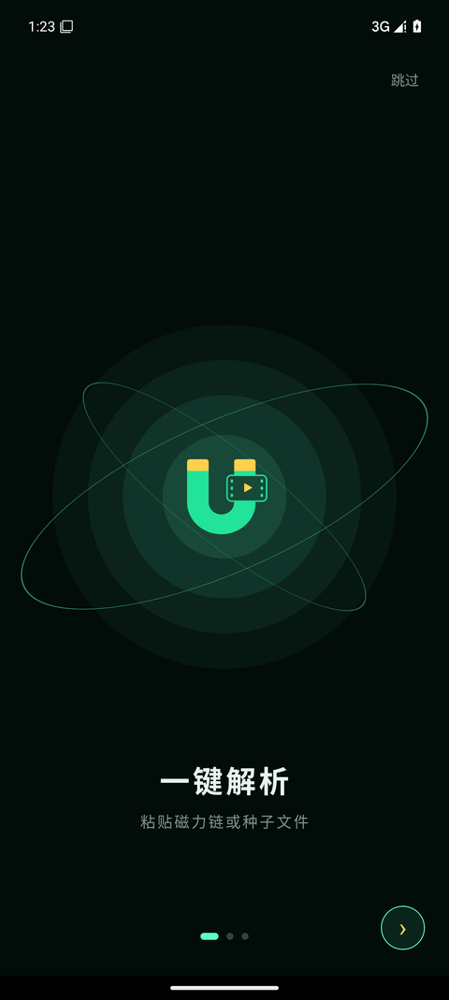
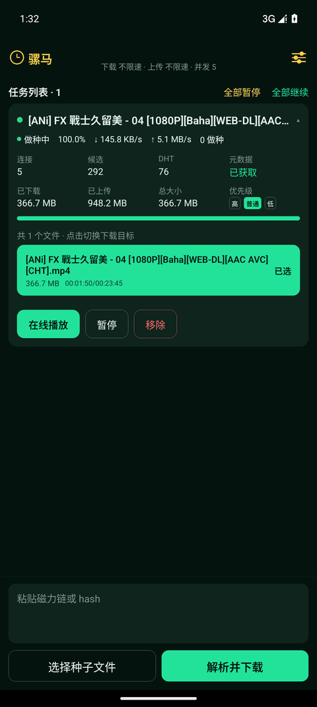
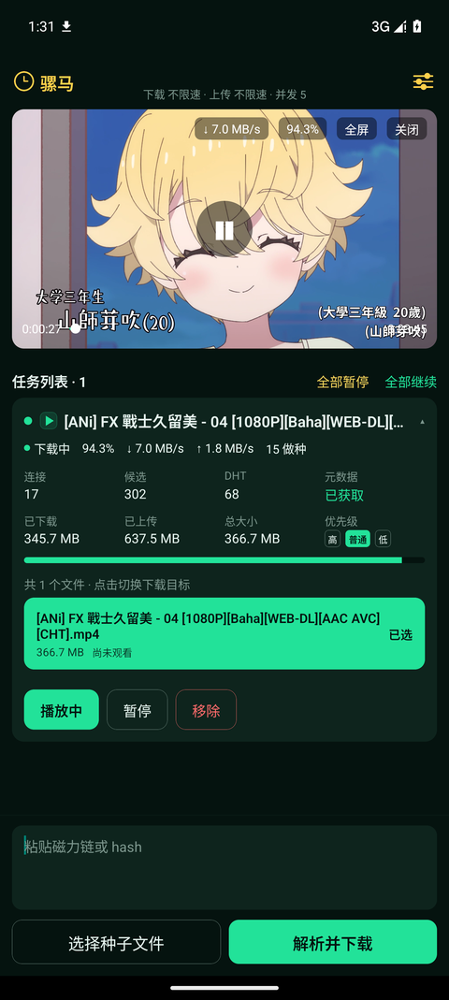
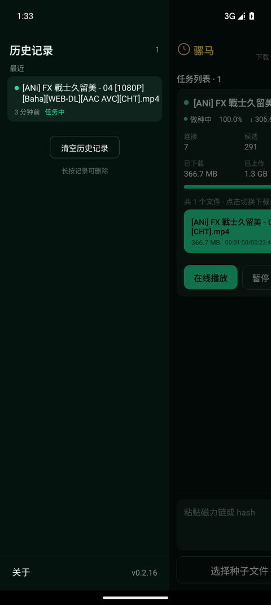
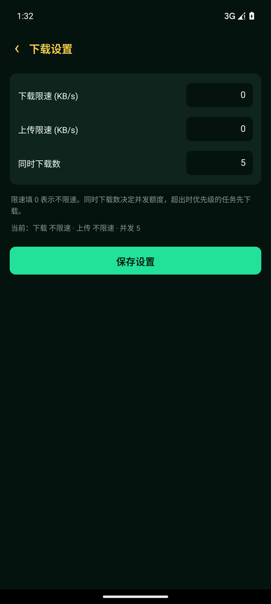

<h1 align="center">🐴 骡马 LuoMaTorrent</h1>

<strong>Android 磁力链播放器 · 边下边播 · 小窗播放 · 后台下载</strong>

粘贴磁力链或选择 <code>.torrent</code> 种子文件即可开始下载，边下边播，无需等待整部视频下载完成。

  
  
  
  
  
  
  
  

  <a href="https://github.com/AchooLuv/LuoMaTorrentAPK/releases/latest"><strong>⬇️ 下载最新版</strong></a> ·
  <a href="#features">功能</a> ·
  <a href="#install">安装</a> ·
  <a href="#faq">常见问题</a>

> 本仓库是**官方 APK 下载页**，只保留 README 与截图；源码仓库为私有。

---

## 📱 当前版本

| | |
|---|---|
| 最新版本 | **v0.4.25** |
| 架构 | 仅 **arm64-v8a** |
| 系统要求 | Android 9（API 28）及以上 |
| 版本号 | versionName 0.4.25 / versionCode 62 |

> 只支持 arm64-v8a：下载引擎的原生库只提供该架构的构建产物。

---

## 🖼️ 截图

  
  
  

  
  

一键解析 · 边下边播 · 多任务并行 · 历史记录 · 小窗播放

---

## ✨ 功能亮点

| | |
|---|---|
| 🧲 **一键解析** | 磁力链直接添加，或选择本地 `.torrent` 文件 |
| ⚡ **边下边播** | 本地 HTTP Range 服务 + ExoPlayer，按播放位置调度分片 |
| 📥 **多任务** | 多个任务并行，单独/批量暂停继续，支持优先级 |
| 🪟 **小窗播放** | 系统悬浮窗，离开 APP 仍可继续观看 |
| 🌙 **后台下载** | 前台服务 + 唤醒锁，切后台继续下载 |
| 🔁 **断点续传** | 每个任务独立保存进度，重启后继续 |
| 🕘 **历史记录** | 搜索、置顶、多选、长按菜单、相对时间分组 |
| 🔄 **应用内更新** | 检查更新、下载 APK、SHA256 校验后安装 |

## 功能说明

### 🧲 添加任务

- 直接粘贴**磁力链接**（`magnet:?xt=urn:btih:...`），无需先下载种子文件
- 也可以从本地选择 `.torrent` **种子文件**
- 相同 infoHash 的种子/磁力链不会重复创建，重复添加会复用原任务
- 多文件种子可单独选择要下载的文件，默认优先选最大的视频
- 纯 v2 种子会明确提示不支持（当前引擎只支持 v1 infohash）

### 📌 最近任务置顶

- 新添加的种子/磁力任务自动移到列表第一项并展开
- 从历史记录打开的任务，无论原来在不在列表中，都会回到第一项并展开
- 点击任务卡片的「在线播放」也会置顶并展开
- 任务重排有过渡动画，展开动作会等重排完成后再执行

### 🗂️ 任务卡片

- 手风琴式展开，同一时间只展开一张
- 左滑露出垃圾桶图标移除任务
- 支持单任务/全部暂停与继续
- 暂停/继续文案按状态显示「暂停下载／继续下载」或「暂停做种／继续做种」
- 支持优先级（高/普通/低）、单独选择文件、查看连接数/DHT/上下行速度
- 每个任务独立保存观看位置，卡片显示已观看进度
- 任务列表和下载队列顺序保持一致

### ▶️ 边下边播

- 内置本地 HTTP Range 服务，配合 ExoPlayer **无需等待下载完成**即可播放
- 按播放位置动态调度分片优先级，优先下载正在观看的部分
- 支持全屏横屏播放，系统返回键退出全屏
- 「继续播放」默认开启，从任务卡片播放时从上次记录位置继续
- 关闭「继续播放」后，只影响任务卡片的在线播放，从 0 开始；全屏切换、小窗播放不受影响

### 🪟 小窗与后台

- 系统悬浮窗小窗播放，离开 APP 后可继续观看
- 「后台播放」开关：离开 APP 时自动小窗继续播放
- 小窗需要「显示在其他应用上层」权限
- 后台下载：前台服务 + 唤醒锁保活，切后台或从最近任务划掉界面都会继续；通知栏显示任务数与实时速度

### 🕘 历史记录

- 左侧抽屉历史记录，搜索框固定在顶部
- 连续子串匹配并高亮
- 置顶记录，置顶区与普通记录分区显示
- 长按打开菜单，来源卡片高亮并在菜单顶部显示记录名称
- 多选模式，支持批量置顶/取消置顶/删除
- 记录按相对时间分组，可标记死种

### ⚙️ 下载与播放设置

- 下载限速、上传限速、同时下载数（1–20，默认 5）
- 播放设置：继续播放、后台播放、悬浮窗权限
- 顶栏显示当前限速与并发，与设置页使用同一套单位格式
- 手动「检查更新」；应用内下载 APK、校验 SHA256 并调用系统安装器

### 👆 手势

- 从屏幕左侧约 **65%** 宽度内向右滑，打开历史记录侧边栏
- 任务卡从右向左滑，露出垃圾桶移除按钮
- 左上角历史图标是固定入口，不依赖手势
- 点击任务卡标题行展开/收起；点击其他卡片会先收起当前卡再展开新卡

## 📥 安装

1. 点击 [下载最新版](https://github.com/AchooLuv/LuoMaTorrentAPK/releases/latest) 下载 `.apk`
2. 系统提示「未知来源应用」时，允许安装
3. 安装完成后打开即用，无需注册或登录

> 正常覆盖安装不会清空应用数据；卸载重装会删除任务、历史记录和已下载文件。

## ❓ 常见问题

<strong>为什么磁力链要等一会儿才出文件列表？</strong>

磁力链本身不含文件列表，必须先连上一个做种者、让对方把种子信息发过来，这一步叫「获取元数据」。

耗时取决于 DHT 节点数、tracker 是否可用，以及当下有多少人做种。冷门资源可能等上几分钟；做种数为 0 的资源则永远拿不到。

<strong>关闭应用后下载会继续吗？</strong>

切到后台、锁屏、从最近任务划掉界面都会继续（前台服务保活）。

但「强行停止」应用或卸载后不会继续；重新打开会从上次进度**断点续传**。

<strong>下载的文件在哪里？</strong>

在应用私有目录内。卸载应用会**连同已下载的文件一起删除**，需要保留的内容请提前导出。

<strong>为什么有的种子一直没速度？</strong>

BT 下载速度完全取决于有多少人在做种。界面上会标记「死种」（长时间拿不到元数据或始终没有做种者），但那只是提示，不代表绝对不可用。

<strong>需要 root 或特殊权限吗？</strong>

不需要。只需要网络权限；Android 13 及以上会请求通知权限用于展示下载进度，拒绝也不影响下载。小窗播放需要额外授予「显示在其他应用上层」权限。

<strong>旧版本和历史记录会丢吗？</strong>

正常覆盖安装不会清空应用数据；卸载重装才会删除任务、历史记录和已下载文件。

---

## 📝 说明

- 每个 Release 的说明里带有 APK 的 MD5 / SHA256，可自行比对
- 下载内容保存在应用私有目录，**卸载应用会一并删除**
- 该应用用于磁力链／种子的下载与播放，请仅用于合法内容
