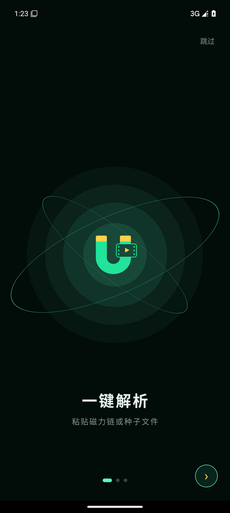
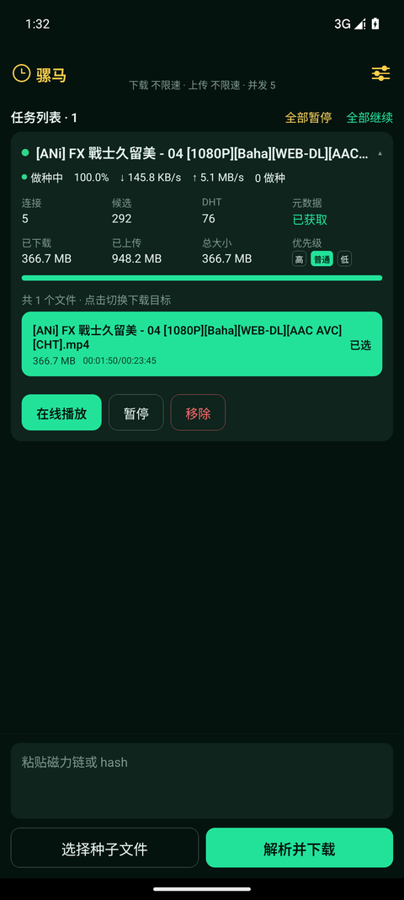
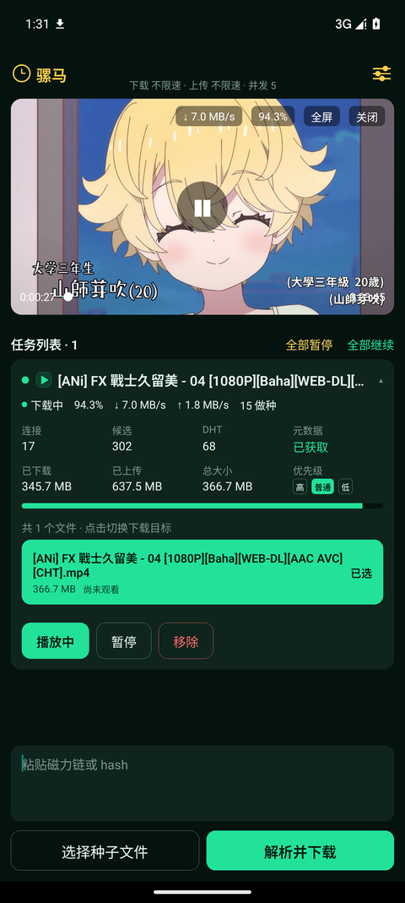
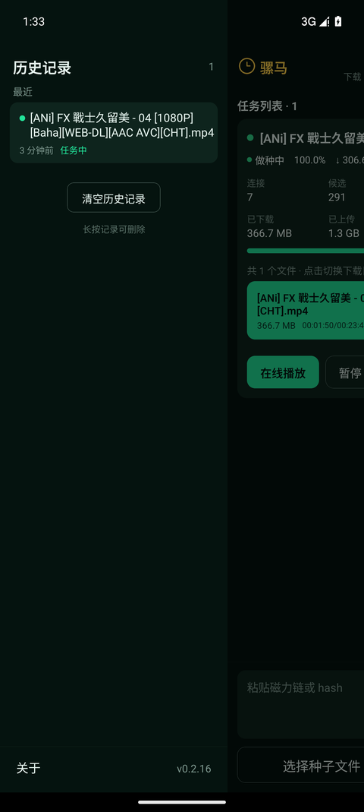
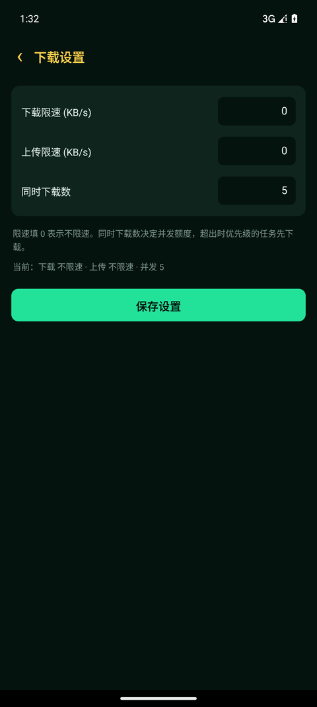

# 骡马 LuoMaTorrent · Android 磁力链播放器

**骡马（LuoMaTorrent）** 是一款 Android 磁力链播放器：粘贴磁力链接或选择 `.torrent` 种子文件即可开始下载，支持**多任务同时下载**、**边下边播**、**后台下载**与**断点续传**。

下载引擎基于 [libtorrent4j](https://github.com/arvidn/libtorrent)（libtorrent-rasterbar），播放基于 ExoPlayer，界面用 React Native 构建，整体为深色霓虹风格。

本仓库是**官方 APK 下载页**，只保留 README 与截图。源码仓库为私有。

- 下载最新版：<https://github.com/AchooLuv/LuoMaTorrentAPK/releases/latest>

---

## 截图

  
  
  

  
  

一键解析 · 边下边播 · 多任务并行 · 观看记录 · 历史与设置

---

## 下载

| | |
|---|---|
| 最新版本 | **v0.2.18**（[Releases](../../releases/latest)） |
| 架构 | 仅 **arm64-v8a**（其他架构设备无法安装） |
| 系统要求 | Android 9（API 28）及以上 |
| 应用大小 | 约 18.5 MB |
| 版本 | versionName 0.2.18 / versionCode 18 |

> 只支持 arm64-v8a：下载引擎的原生库只提供了这个架构的构建产物。

## 安装

1. 下载 `.apk` 文件
2. 系统会提示「未知来源应用」，需要允许安装
3. 安装完成后打开即用，无需注册或登录

## 功能特性

### 一键解析

- 直接粘贴**磁力链接**（`magnet:?xt=urn:btih:...`），无需先下载种子文件
- 也可以从本地选择 `.torrent` **种子文件**
- 多文件种子可单独选择要下载的那一个
- 纯 v2 种子会给出明确提示（当前引擎只支持 v1 infohash）

### 边下边播

- 内置本地 HTTP Range 服务，配合 ExoPlayer **无需等待下载完成**即可播放
- 按播放位置动态调度分片优先级，优先下载正在观看的部分
- 支持全屏横屏播放，系统返回键退出全屏

### 多任务并行

- 多个**磁力任务同时下载**，默认并发 **5** 个，可单独或批量暂停／继续
- **后台下载**：前台服务 + 唤醒锁保活，切后台或从最近任务划掉界面都会继续；通知栏显示任务数与实时速度
- **下载／上传限速**，任务优先级分高／普通／低
- 每个任务独立保存进度，**断点续传**，关闭应用后重新打开可继续
- 历史记录按加入时间分组，可标记死种并一键清理

### 手势

- 从屏幕左侧约 **65%** 宽度内向右滑，打开历史记录侧边栏
- 任务卡从右侧向左滑，露出「移除」
- 左上角历史图标是固定入口，不依赖手势

## 常见问题

**Q：为什么磁力链要等一会儿才出文件列表？**

磁力链本身不含文件列表，必须先连上一个做种者、让对方把种子信息发过来，这一步叫「获取元数据」。
耗时取决于 DHT 节点数、tracker 是否可用，以及当下有多少人做种。冷门资源可能等上几分钟；做种数为 0 的资源则永远拿不到。

**Q：关闭应用后下载会继续吗？**

切到后台、锁屏、从最近任务划掉界面都会继续（前台服务保活）。
但「强行停止」应用或卸载后不会继续；重新打开会从上次进度**断点续传**。

**Q：下载的文件在哪里？**

在应用私有目录内。卸载应用会**连同已下载的文件一起删除**，需要保留的内容请提前导出。

**Q：为什么有的种子一直没速度？**

BT 下载速度完全取决于有多少人在做种。界面上会标记「死种」（长时间拿不到元数据或始终没有做种者），但那只是提示，不代表绝对不可用。

**Q：需要 root 或特殊权限吗？**

不需要。只需要网络权限；Android 13 及以上会请求通知权限用于展示下载进度，拒绝也不影响下载。

## 说明

- 每个 Release 的说明里带有 APK 的 MD5 / SHA256，可自行比对
- 下载内容保存在应用私有目录，**卸载应用会一并删除**
- 该应用用于磁力链／种子的下载与播放，请仅用于合法内容
